# Architecture

<!-- Derived file: written by `python3 .claude/tools/mapctl.py architecture` from
     .claude/system-map/architecture.json (the generator architecture_build, run by
     /project-memory). Hand edits are lost on the next build: change the cards instead. -->

One diagram per scope. Boxes are components, grouped by layer: a rectangle is code, a
stadium an agent, a cylinder a data store, a circle the human, a double-edged box a folder
(stores folded together, or a group's least-connected components). Solid arrows write or
invoke, dashed arrows read; `xN` is how many card relations an arrow stands for. Click a
box to open its file.

## .claude system (`claude`)

Root `.claude`, built from the system-map cards.

```mermaid
flowchart LR
  subgraph g_memory["MEMORY"]
    hook_session_start["session-start"]
    skill_plan_task["/plan-task"]
    tool_statectl["statectl"]
    reference_distribution_boundary[("distribution-boundary")]
    store_lessons[("lessons")]
    store_project_log[("project_log")]
  end
  subgraph g_govern["GOVERN"]
    agent_builder(["builder"])
    agent_scout(["scout"])
    agent_verifier(["verifier"])
    hook_handoff_guard["handoff-guard"]
    hook_policy_gate["policy-gate"]
    hook_post_write_validate["post-write-validate"]
    hook_ritual_ticket["ritual-ticket"]
    protocol_evolution[("evolution")]
    folder_config[[".claude/config/"]]
    folder_state[[".claude/state/"]]
    other_govern[["other (6)"]]
  end
  subgraph g_observe["OBSERVE"]
    hook_heartbeat["heartbeat"]
    hook_obs_capture["obs-capture"]
    tool_obsctl["obsctl"]
    folder_claude_iff[[".claude-iff/"]]
    folder_record[["record root"]]
  end
  subgraph g_console["CONSOLE"]
    console_server["server"]
    tool_consolectl["consolectl"]
    tool_ctxmap["ctxmap"]
    tool_mapctl["mapctl"]
    tool_progress["progress"]
    tool_sysmon["sysmon"]
    console_template[("template")]
    folder_system_map[[".claude/system-map/"]]
  end
  subgraph g_evolve["EVOLVE"]
    agent_anatomist(["anatomist"])
    agent_retro_analyst(["retro-analyst"])
    skill_adopt["/adopt"]
    skill_project_memory["/project-memory"]
    tool_checkctl["checkctl"]
    tool_distctl["distctl"]
    store_dist[("dist")]
  end
  subgraph g_unplaced["unplaced"]
    skill_adhd["/adhd"]
    tool__lib["_lib"]
    human_maintainer(("maintainer"))
  end
  agent_anatomist -->|writes| folder_state
  agent_anatomist -.->|reads x2| folder_system_map
  agent_anatomist -->|writes x2| folder_system_map
  agent_anatomist -->|invokes| tool_mapctl
  agent_anatomist -->|invokes| tool_obsctl
  agent_anatomist -->|invokes| tool_statectl
  agent_builder -.->|reads| folder_state
  agent_builder -->|writes| folder_state
  agent_builder -->|invokes| tool_checkctl
  agent_retro_analyst -.->|reads| folder_claude_iff
  agent_retro_analyst -.->|reads| folder_state
  agent_retro_analyst -.->|reads| protocol_evolution
  agent_retro_analyst -.->|reads| store_lessons
  agent_retro_analyst -.->|reads| store_project_log
  agent_scout -->|writes| folder_state
  agent_verifier -->|writes| folder_state
  console_server -.->|reads| folder_config
  console_server -->|invokes| tool_consolectl
  console_server -->|invokes| tool_sysmon
  hook_handoff_guard -.->|reads x3| folder_state
  hook_handoff_guard -->|writes| folder_state
  hook_handoff_guard -->|invokes| tool__lib
  hook_heartbeat -->|writes| folder_state
  hook_heartbeat -->|invokes| tool__lib
  hook_obs_capture -.->|reads x2| folder_config
  hook_obs_capture -->|writes| folder_record
  hook_obs_capture -->|writes| folder_state
  hook_policy_gate -.->|reads x2| folder_config
  hook_policy_gate -->|writes| folder_state
  hook_policy_gate -->|invokes| tool__lib
  hook_post_write_validate -.->|reads x3| folder_state
  hook_post_write_validate -->|writes| folder_state
  hook_post_write_validate -->|invokes| tool__lib
  hook_post_write_validate -->|invokes| tool_progress
  hook_ritual_ticket -.->|reads| folder_config
  hook_ritual_ticket -->|writes| folder_record
  hook_ritual_ticket -->|writes| folder_state
  hook_session_start -->|invokes| console_server
  hook_session_start -.->|reads x3| folder_config
  hook_session_start -.->|reads| folder_record
  hook_session_start -.->|reads x3| folder_state
  hook_session_start -->|invokes| tool__lib
  hook_session_start -->|invokes| tool_statectl
  skill_adhd -.->|reads| folder_config
  skill_adopt -->|invokes| agent_anatomist
  skill_adopt -->|writes| folder_config
  skill_adopt -->|invokes| tool__lib
  skill_adopt -->|invokes| tool_checkctl
  skill_adopt -->|invokes| tool_consolectl
  skill_adopt -->|invokes| tool_mapctl
  skill_adopt -->|invokes| tool_statectl
  skill_plan_task -->|invokes| tool_statectl
  skill_project_memory -->|invokes| agent_anatomist
  skill_project_memory -->|invokes| agent_retro_analyst
  skill_project_memory -->|writes| store_lessons
  skill_project_memory -->|writes| store_project_log
  skill_project_memory -->|invokes| tool_checkctl
  skill_project_memory -->|invokes| tool_statectl
  tool__lib -.->|reads x4| folder_config
  tool__lib -->|writes| folder_record
  tool__lib -.->|reads x4| folder_state
  tool__lib -->|writes x3| folder_state
  tool_checkctl -.->|reads x8| folder_config
  tool_checkctl -.->|reads x7| folder_state
  tool_checkctl -->|writes x3| folder_state
  tool_checkctl -->|invokes| tool_consolectl
  tool_checkctl -->|invokes| tool_mapctl
  tool_checkctl -->|invokes| tool_obsctl
  tool_checkctl -->|invokes| tool_statectl
  tool_consolectl -->|invokes| console_server
  tool_consolectl -.->|reads| console_template
  tool_consolectl -.->|reads| folder_claude_iff
  tool_consolectl -.->|reads x3| folder_config
  tool_consolectl -.->|reads x7| folder_state
  tool_consolectl -.->|reads| folder_system_map
  tool_consolectl -.->|reads| store_lessons
  tool_consolectl -.->|reads| store_project_log
  tool_consolectl -->|invokes| tool_progress
  tool_ctxmap -.->|reads| store_lessons
  tool_ctxmap -.->|reads| store_project_log
  tool_distctl -.->|reads x2| folder_config
  tool_distctl -.->|reads| folder_system_map
  tool_distctl -->|writes| store_dist
  tool_distctl -->|invokes| tool_checkctl
  tool_mapctl -.->|reads x2| folder_system_map
  tool_mapctl -->|writes x3| folder_system_map
  tool_obsctl -.->|reads| folder_claude_iff
  tool_obsctl -->|writes x2| folder_claude_iff
  tool_obsctl -.->|reads x3| folder_config
  tool_obsctl -.->|reads| folder_record
  tool_obsctl -->|writes| folder_record
  tool_obsctl -.->|reads| folder_state
  tool_obsctl -->|writes| folder_state
  tool_progress -.->|reads x5| folder_state
  tool_progress -->|invokes| tool__lib
  tool_progress -->|invokes| tool_checkctl
  tool_progress -->|invokes| tool_statectl
  tool_statectl -.->|reads| folder_config
  tool_statectl -.->|reads x5| folder_state
  tool_statectl -->|writes x7| folder_state
  tool_statectl -->|invokes| tool_checkctl
  tool_statectl -->|invokes| tool_progress
  click hook_session_start "https://github.com/Sdamirsa/dot-claude-iff/blob/dev/.claude/hooks/session-start.sh"
  click skill_plan_task "https://github.com/Sdamirsa/dot-claude-iff/blob/dev/.claude/skills/plan-task/SKILL.md"
  click tool_statectl "https://github.com/Sdamirsa/dot-claude-iff/blob/dev/.claude/tools/statectl.py"
  click reference_distribution_boundary "https://github.com/Sdamirsa/dot-claude-iff/blob/dev/.claude/reference/distribution-boundary.md"
  click store_lessons "https://github.com/Sdamirsa/dot-claude-iff/blob/dev/.claude/LESSONS.jsonl"
  click store_project_log "https://github.com/Sdamirsa/dot-claude-iff/blob/dev/.claude/Project-log.jsonl"
  click agent_builder "https://github.com/Sdamirsa/dot-claude-iff/blob/dev/.claude/agents/builder.md"
  click agent_scout "https://github.com/Sdamirsa/dot-claude-iff/blob/dev/.claude/agents/scout.md"
  click agent_verifier "https://github.com/Sdamirsa/dot-claude-iff/blob/dev/.claude/agents/verifier.md"
  click hook_handoff_guard "https://github.com/Sdamirsa/dot-claude-iff/blob/dev/.claude/hooks/handoff-guard.sh"
  click hook_policy_gate "https://github.com/Sdamirsa/dot-claude-iff/blob/dev/.claude/hooks/policy-gate.sh"
  click hook_post_write_validate "https://github.com/Sdamirsa/dot-claude-iff/blob/dev/.claude/hooks/post-write-validate.sh"
  click hook_ritual_ticket "https://github.com/Sdamirsa/dot-claude-iff/blob/dev/.claude/hooks/ritual-ticket.sh"
  click protocol_evolution "https://github.com/Sdamirsa/dot-claude-iff/blob/dev/.claude/protocols/evolution.md"
  click folder_config "https://github.com/Sdamirsa/dot-claude-iff/blob/dev/.claude/config"
  click folder_state "https://github.com/Sdamirsa/dot-claude-iff/blob/dev/.claude/state"
  click other_govern "https://github.com/Sdamirsa/dot-claude-iff/blob/dev/.claude"
  click hook_heartbeat "https://github.com/Sdamirsa/dot-claude-iff/blob/dev/.claude/hooks/heartbeat.sh"
  click hook_obs_capture "https://github.com/Sdamirsa/dot-claude-iff/blob/dev/.claude/hooks/obs-capture.sh"
  click tool_obsctl "https://github.com/Sdamirsa/dot-claude-iff/blob/dev/.claude/tools/obsctl.py"
  click folder_claude_iff "https://github.com/Sdamirsa/dot-claude-iff/blob/dev/.claude-iff"
  click console_server "https://github.com/Sdamirsa/dot-claude-iff/blob/dev/.claude/console/console.py"
  click tool_consolectl "https://github.com/Sdamirsa/dot-claude-iff/blob/dev/.claude/tools/consolectl.py"
  click tool_ctxmap "https://github.com/Sdamirsa/dot-claude-iff/blob/dev/.claude/tools/ctxmap.py"
  click tool_mapctl "https://github.com/Sdamirsa/dot-claude-iff/blob/dev/.claude/tools/mapctl.py"
  click tool_progress "https://github.com/Sdamirsa/dot-claude-iff/blob/dev/.claude/tools/progress.py"
  click tool_sysmon "https://github.com/Sdamirsa/dot-claude-iff/blob/dev/.claude/tools/sysmon.py"
  click console_template "https://github.com/Sdamirsa/dot-claude-iff/blob/dev/.claude/console/console.template.html"
  click folder_system_map "https://github.com/Sdamirsa/dot-claude-iff/blob/dev/.claude/system-map"
  click agent_anatomist "https://github.com/Sdamirsa/dot-claude-iff/blob/dev/.claude/agents/anatomist.md"
  click agent_retro_analyst "https://github.com/Sdamirsa/dot-claude-iff/blob/dev/.claude/agents/retro-analyst.md"
  click skill_adopt "https://github.com/Sdamirsa/dot-claude-iff/blob/dev/.claude/skills/adopt/SKILL.md"
  click skill_project_memory "https://github.com/Sdamirsa/dot-claude-iff/blob/dev/.claude/skills/project-memory/SKILL.md"
  click tool_checkctl "https://github.com/Sdamirsa/dot-claude-iff/blob/dev/.claude/tools/checkctl.py"
  click tool_distctl "https://github.com/Sdamirsa/dot-claude-iff/blob/dev/.claude/tools/distctl.py"
  click store_dist "https://github.com/Sdamirsa/dot-claude-iff/blob/dev/.claude/dist"
  click skill_adhd "https://github.com/Sdamirsa/dot-claude-iff/blob/dev/.claude/skills/adhd/SKILL.md"
  click tool__lib "https://github.com/Sdamirsa/dot-claude-iff/blob/dev/.claude/tools/_lib.py"
```

- **MEMORY**: Durable project memory: status, decision log, lessons, tasks, research, reference.
- **GOVERN**: Gates and contracts: policy enforcement, write validation, handshake envelopes, human gates.
- **OBSERVE**: The always-on record: capture, heartbeat, seal, rollup, anchor, token ledger, retrospective analysis.
- **CONSOLE**: One page of command and control: NOW, MAP, STORY, WORK.
- **EVOLVE**: The system changing itself on evidence: the ritual, retro proposals, the anatomist, pruning.
- **unplaced**: Components the anatomist has not yet placed into a flow layer. Visible by design.

Folded boxes:

- `.claude/config/`: `config.brainstorm`, `config.console`, `config.memory`, `config.model-prices`, `config.observe`, `config.orchestration`, `config.phases`, `config.policy`, `config.publish`, `config.registry`
- `.claude/state/`: `store.generators`, `store.handoff`, `store.handshakes`, `store.heartbeat`, `store.journal`, `store.machine`, `store.memory_run`, `store.needs_human`, `store.orchestration`, `store.proposals`, `store.ritual_ticket`, `store.session`, `store.story`
- `other (6)`: `protocol.handshake`, `protocol.honesty`, `protocol.human-gates`, `protocol.orchestration`, `reference.public-private`, `reference.secrets`
- `.claude-iff/`: `store.anchor`, `store.rollups`
- `record root`: `store.record`
- `.claude/system-map/`: `map.layers`, `store.architecture`, `store.cards`, `store.map`
